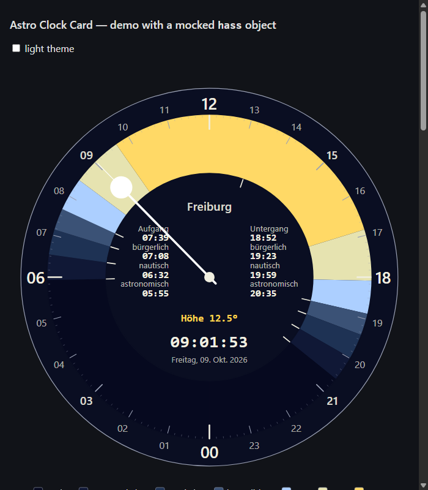

# Astro Clock Card

A 24-hour astronomical clock for Home Assistant dashboards.



The dial shows the current local day as colored arcs (night, astronomical, nautical and civil twilight, and day). Within the day span it highlights where the sun stands higher than configurable elevations (default 7° and 18°). A hand marks the current time. The center shows dawn and dusk times, the current apparent sun elevation and the date.

- No dependencies, no build step: a single JavaScript file.
- Location and time zone are taken from Home Assistant, and can be overridden per card.
- All calculations run in the browser. The card does not need the `sun.sun` entity.

## Installation

### HACS (custom repository)

1. In HACS, open the menu (⋮) → **Custom repositories**.
2. Add `https://github.com/phija/astro-clock-card` with type **Dashboard**.
3. Install **Astro Clock Card** and reload the browser.

HACS registers the dashboard resource automatically.

### Manual

1. Copy `dist/astro-clock-card.js` to `<config>/www/astro-clock-card.js`.
2. Go to **Settings → Dashboards → ⋮ → Resources** and add `/local/astro-clock-card.js` as a **JavaScript module**.
3. Reload the browser.

## Usage

Minimal configuration:

```yaml
type: custom:astro-clock-card
```

All options:

```yaml
type: custom:astro-clock-card
name: Freiburg               # default: location name from Home Assistant
latitude: 47.983             # default: Home Assistant home location
longitude: 7.795             # set both or neither
time_zone: Europe/Berlin     # default: per your HA profile (server or browser zone)
language: de                 # default: HA language; built in: en, de
elevation_zones: [7, 18]     # up to 4 elevations in degrees (0–89.9); [] disables
elevation_zone_colors: ['#e6e3b0', '#ffd966']
show_legend: true
show_times: true
show_elevation: true
colors:                      # any subset
  night: '#06091f'
  astronomical_twilight: '#101836'
  nautical_twilight: '#1e3254'
  civil_twilight: '#3b5276'
  day: '#accfff'
  face: '#0a0e22'
  tick_major: '#f0eee0'
  tick_minor: '#9aa0b4'
  label: '#f0eee0'
  hand: '#ffffff'
  sun: '#ffd34d'
```

## How it is calculated

- **Sun position:** NOAA / Meeus low-precision solar position (accuracy about 0.01°).
- **Twilight limits:** geometric altitude of the sun's center at −18° (astronomical), −12° (nautical) and −6° (civil). Sunrise and sunset use −0.833°, which covers refraction at the horizon plus the sun's semi-diameter. This is the usual convention. Results agree with the [MeeusSunMoon](https://github.com/janrg/MeeusSunMoon) library to within a few seconds.
- **Elevation zones and the elevation readout:** use the *apparent* altitude, i.e. geometric altitude plus atmospheric refraction (NOAA approximation, 10 °C, 1010 hPa). Close to and below the horizon this approximation is less exact.
- **Dial and DST:** the dial shows local wall-clock time for the current day. On days with a DST change, the ring and the hand use the same mapping.
- **Times in the center panel:** anchored on the day's solar transit. At high latitudes, dusk after midnight is therefore still shown correctly. If an event does not occur on that day (polar day or night, no astronomical night in summer), the panel shows "—".

## Development

Open `demo/index.html` in a browser. It loads the card with a mocked `hass` object and shows several locations and time zones.

## License

MIT — see [LICENSE](LICENSE).
